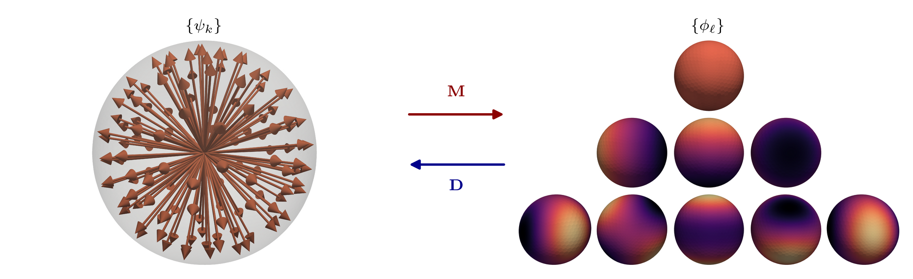

.. _angular_discretisation:
Angular discretisation
--------------------------

The equation is now set to hold at :math:`K` discreteangles while the integral over the unit sphere is approximated by a discrete quadrature:

.. math::
    \int_{S^2} f(\Omega)\, d \Omega = \sum_{\kappa }w_{\kappa} f_{\kappa}
The subscript means the evalution at the discrete angle :math:`\Omega_{\kappa}` and :math:`w_{\kappa}` is the quadrature weight associated with that angle.

The multigroup equation then becomes the following discrete set of coupled PDEs:

.. math::
    \left[\Omega_k \cdot \nabla  + \sigma_g(\mathbf{r})\right]\psi_{gk}(\mathbf{r}) - \sum_{\ell}\sum_{\tilde{g}}Y_{\ell k } \sigma^s_{\ell  g  \tilde{g}}(\mathbf{r}) \left[\sum_{\kappa} w_{\kappa} Y_{\ell \kappa } \psi_{\tilde{g}\kappa}(\mathbf{r})\right]=  q_{gk}(\mathbf{r}) \ \ \ \forall g,k

which is a :math:`G\times K` system of 3D partial differential equations.

Let us now introduce the operator notation to simplify the notation. The term in square brackets is:

.. math::
    \sum_k w_k Y_{\ell}(\Omega_k) \psi_{gk}(\mathbf{r}) \approx  \int_{S^2} Y_{\ell}(\Omega) \psi_{g}(\mathbf{r},\Omega)\,d \Omega = \phi_{g \ell}(\mathbf{r}) 

where :math:`\phi_{g \ell}(\mathbf{r})` is the :math:`\ell`-th moment of the angular flux in group :math:`g`. These are the angular moments of the neutron flux --- zero is scalar flux, higher are 
the anisotropic moments. Since the spherical harmonics are orthogonal, they are precisely the expansion coefficients of the projection to a finite spherical harmonic basis:

.. math::
    \psi_{g}(\mathbf{r},\Omega) \approx \sum_{\ell }Y_{\ell}(\Omega) \phi_{g\ell}(\mathbf{r})

Thus in the discrete ordinates equation, there are two angular descriptions: one is the discrete angles :math:`k`, and the other is the spherical harmonic 
expansion coefficients :math:`\ell` (naturally arise from scattering). 

We now use a free index (not summed over) to mean the full array and implicitly, :math:`k,\ell` will indicate angle and moment indices. Dots indicate freely batched indices (i.e., picking out
the particular index).  Then, we can define the angles-to-moments operator :math:`\mathbf{M}`, the moments-to-angles operator :math:`\mathbf{D}`, and the scattering operator :math:`\mathfrak{s}` as:

.. math::
    \mathbf{M}[a_{\dots k\dots}]                       &=  \sum_{k} w_k Y_{\ell k} a_{\dots k\dots} \label{eq:m_definition_nmd} \\
    \mathbf{D}[b_{\dots \ell \dots}]                       &=  \sum_{\ell} Y_{\ell k} b_{\dots \ell \dots} \label{eq:d_definition_nmd}\\    
    \mathfrak{s}(\mathbf{r})[d_{\dots \tilde{g} \ell\dots }] &=\sum_{\tilde{g}} \sigma^s_{\ell g\tilde{g}} d_{\dots \tilde{g}\ell \dots }

In other words, the dots imply that 

.. math::
    \mathbf{M}[a_{gkei}(\mathbf{r})] = \sum_{k}w_k Y_{\ell k }a_{gkei}(\mathbf{r})

These :math:`\mathbf{M}` and :math:`\mathbf{D}` operators convert between the two representations, as in the figure below.

The total transport operator is then (diagonal: only a single :math:`g,k`)

.. math::
    \boldsymbol{\tau}(\mathbf{r}) [f_{gk}] =\Omega_k \cdot \nabla f_{gk} + \sigma_g(\mathbf{r}) f_{gk} 

The discrete ordinates multigroup transport equation can then be written in a compact form as:

.. math::
    \left(\boldsymbol{\tau} - \mathbf{D} \circ \mathfrak{s} \circ \mathbf{M}\right)[ \psi_{gk}(\mathbf{r})]=  q_{gk}(\mathbf{r})
    
This is a :math:`G\times K` system of 3D PDEs written in a compact operator notation.