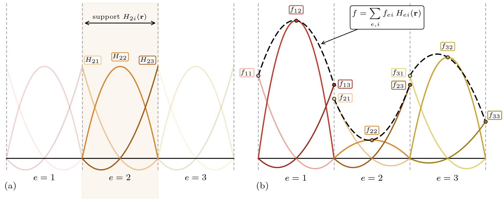

Spatial Discretisation
--------------------------

Discontinuous Galerkin is used for the spatial discretisation. This is a generalisation of the finite element methods where discontinuous function
values are accepted. 

The domain is discretised into :math:`N` elements :math:`e`, and each element has a set of basis functions :math:`H_{ei}`. In classical 
finite elements, the basis functions have finite values for multiple elements (e.g. they are a basis function belonging to a node of the mesh),
but in discontinuous Galerkin, they are only non-zero within their respective element (finite elements can be obtained by requiring that degrees-of-freedom (DOF) are consistent on each edge node).

The basis functions span a sub-space of :math:`L^2`, and consequently, an arbitrary function :math:`f` within that subspace can be defined 
by a set of coefficients :math:`f_{ei}` as

.. math::
    f(\mathbf{r}) = \sum_{e,i} f_{ei} H_{ei}(\mathbf{r})

For an interval element, both the basis function and the resulting function approximation are shown below.

    
Discontinuous Galerkin methods then try to find the best approximation of the solution of the transport equation within that subspace. 

Let :math:`\psi_{gk}`, :math:`q_{gk}` be the angular flux for group :math:`g` and direction :math:`k` within that subspace, and the source term for group :math:`g` and direction :math:`k`, respectively.
Multiplying the equation by a basis function :math:`H_{\epsilon j}` and integrating over the element :math:`\epsilon`, requiring the resulting equation to hold
for all :math:`\epsilon,j` yields the following weak form of the :math:`G\times K` transport system:

.. math::
    \int_\epsilon \boldsymbol{\tau} \left[\psi_{gk}\right] H_{\epsilon j }\, d V - \int_\epsilon  \mathbf{D} \mathfrak{s} \mathbf{M}\left[\psi_{gk}\right] H_{\epsilon j}\, d  V =  \int_{\epsilon}  H_{\epsilon j } q_{gk} \, d V \ \ \ \forall \epsilon,j 

The first term is currently undefined: it contains a :math:`nalba \psi_{gk}` term, which, as :math:`\psi_{gk}` is discontinuous, is not defined.

Instead, it can be partially integrated first:

.. math::
     \int_{\epsilon}\Omega_k \cdot \nabla \psi_{gk} H_{\epsilon j } \, d V = \int_{\partial \epsilon} H_{\epsilon j }\hat{\psi}_{gk} \Omega_k \cdot \mathbf{n}\, d A - \int_{\epsilon}\psi_{gk} \Omega_k \cdot \nabla   H_{\epsilon j}\, d V 

where the partial integration was performed over the element boundary :math:`\partial \epsilon` and :math:`\mathbf{n}` is the normal vector along that boundary.

The hat denotes a real ambiguity: the value on the boundary differs between the element :math:`\epsilon` and the element connected to it through that boundary.

We now make two additional assumptions

- Elements have straight faces.
- The cross section is constant within an element.

From this point, :math:`\epsilon,j` denote the test function (with which the equation is multiplied and integrated) while :math:`e,i` are the basis function indices
from the expansion of :math:`\psi_{gk}`. The angular flux is expanded as 

.. math::
    \psi_{gk}(\mathbf{r}) = \sum_{e,i} \psi_{gkei} H_{ei}(\mathbf{r})

and noting that the integration of :math:`\epsilon`, due to the finite support of the basis functions, only has non-zero contributions for :math:`e = \epsilon`,
the transport operator can be written in a discontinuous-Galerkin form (taking a set of discrete coefficients :math:`\psi_{gkei}` as input and returning a set of discrete coefficients defined on :math:`gk\epsilon j` as output):

.. math::
    \mathbf{T} [\psi_{gkei}] =  \sum_{i}\psi_{gk\epsilon i}\int_{\epsilon} H_{\epsilon i}\left[ \sigma_g H_{\epsilon j} - \Omega_k \cdot \nabla   H_{\epsilon j}\right]\, d V +  \int_{\partial \epsilon} H_{\epsilon j }\hat{\psi}_{gk} \Omega_k \cdot \mathbf{n}\, d A \ \  \left(= T_{gk\epsilon j}\right)

which is actually the full :math:`G\times K \times N \times B` coefficient set, where :math:`B` is the number of basis functions per element. 

After we use the assumption that the cross section is constant within an element, it can be taken out of the integral, making the scattering a simple 
element-wise multiplication. Then, the mass and scattering operators are defined as 

.. math::
    \mathbf{H}[a_{\dots e i}] &= \sum_{i}  a_{\dots \epsilon i}\int_{\epsilon} H_{\epsilon j } H_{\epsilon i} \, d V \label{eq:h_operator_nmd}\\    
    \mathbf{S}[b_{\tilde{g}\ell \epsilon \dots  }]               &= \sum_{\tilde{g}} \sigma^s_{\ell g\tilde{g} \epsilon  }b_{\tilde{g}\ell \epsilon \dots}

The dots indicate irrelevant indices, as before. :math:`\mathbf{H}` is the mass operator mapping indices :math:`...ei` to indices :math:`...\epsilon j` (note :math:`e` does not shop up because it is only non-zero for :math:`e = \epsilon`), 
and :math:`\mathbf{S}` is the scattering operator mapping indices :math:`\tilde{g}\ell \epsilon ...` to indices :math:`g\ell \epsilon ...` (the constant-cross-section version of :math:`\mathfrak{s}`).

The :math:`\mathbf{H}` operator commutes with all others except :math:`\mathbf{T}` since it only acts on the indices :math:`i`.

Using these definitions (and the preceding moment and discrete operators) we have the we can write the transport equation (expanding also :math:`q_{gk}` in its coefficients) as:

.. math::
    \left(\mathbf{T} -   \mathbf{D} \mathbf{S} \mathbf{M} \mathbf{H}\right)\left[\psi_{gk ei} \right] =  \mathbf{H}[q_{gkei}]

giving an operator form of the multigroup, discrete-ordinates, discontinuous-Galerkin discretised transport equation. In principle,
this can be used to solve for the coefficients :math:`\psi_{gkei}` given a source term :math:`q_{gkei}` in a matrix-free fashion, as desired. 

Sweep Preconditioning
----------------------
A major problem is that information only propagates one element in a operator application: a element with 1 with the rest 0 will only transport that value
one element per iteration. In a linear mesh, this thus takes :math:`N` iterations to propagate information from one end of the mesh to the other. 
For a :math:`d` dimensional mesh, this thus takes :math:`\propto N^{1/d}` iterations to propagate information from one end of the mesh to the other.        

This does not even include scattering converging, which can also take quite some iterations in highly-scattering regimes. This compounds.

Fortunately, the transport operator admits an inversion that takes roughly the same amount of time as a single operator application. This 
thus propagates information across the entire mesh in a single iteration. Before showing this sweep, let us show how the operator will look like.

.. math::
    \left(\mathbf{I} - \mathbf{T}^{-1} \mathbf{D}\mathbf{S} \mathbf{M} \mathbf{H}\right)[\psi_{gkei}] = \mathbf{T}^{-1}\mathbf{H}[q_{gkei}]

Commuting :math:`\mathbf{H}` to the right-hand side, we have

.. math::
    \left(\mathbf{I} - \mathbf{T}^{-1} \mathbf{H} \mathbf{D}\mathbf{S} \mathbf{M} \right)[\psi_{gkei}] = \mathbf{T}^{-1}\mathbf{H}[q_{gkei}]

For scattering, only the moments :math:`\mathbf{M}[\psi_{gkei]` are required. Since they are much less numereous than the number of angles,
it is advantageous to transform the unknowns the :math:`\phi_{g\ell ei}` instead. This requires multiplying both sides by :math:`\mathbf{M}`:

.. math::
    \left(\mathbf{I} -\mathbf{M} \mathbf{T}^{-1} \mathbf{H} \mathbf{D}\mathbf{S} \right)[\phi_{g\ell ei}] = \mathbf{M}\mathbf{T}^{-1}\mathbf{H}[q_{gkei}]

or if the source is defined in moment space:

.. math::
    \left(\mathbf{I} -\mathbf{M} \mathbf{T}^{-1} \mathbf{H} \mathbf{D}\mathbf{S} \right)[\phi_{g\ell ei}] = \mathbf{M}\mathbf{T}^{-1}\mathbf{H}\mathbf{D}[q_{g\ell ei}]

This is the version that can be efficiently solved with any iterative solver.

Transport operator inversion
~~~~~~~~~~~~~~~~~~~~~~~~~~~~~

The transport operator is always diagonal in the :math:`g,k` indices; it does not couple these. Obtaining an inverse is thus equal to  inverting each 
:math:`g,k` index separately. For brevity, we just drop the indices in this section.

.. math::
    T[\psi_{ei}] = \sum_{i}\psi_{\epsilon i}\int_{\epsilon} H_{\epsilon i}\left[ \sigma H_{\epsilon j} - \Omega \cdot \nabla   H_{\epsilon j}\right]\, d V +  \int_{\partial \epsilon} H_{\epsilon j }\hat{\psi} \Omega \cdot \mathbf{n}\, d A

The upwind flux is used as the numerical flux and is defined as:

.. math::
    \hat{\psi} = \begin{cases}
        \sum_{i} \psi_{\epsilon i} H_{\epsilon i}  & \Omega \cdot \mathbf{n}(\mathbf{s}) \geq 0 \\
        \sum_{i} \psi_{\epsilon(\mathbf{s}) i} H_{\epsilon(\mathbf{s}) i } & \Omega \cdot \mathbf{n}(\mathbf{s}) < 0
    \end{cases}

where :math:`\epsilon(\mathbf{s})` is the element connected to :math:`\epsilon` through the boundary point :math:`\mathbf{s}`.

