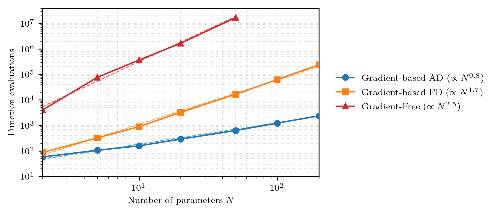

Basic Information
--------------------

The neutron transport equation 

.. math::
       \Omega \cdot \nabla \psi(\mathbf{r}, \Omega, E) + &\sigma(\mathbf{r}, \Omega) \psi(\mathbf{r}, \Omega, E) \\
     &=\iint \sigma_s(\mathbf{r}, \Omega' \to \Omega, E' \to E) \psi(\mathbf{r}, \Omega', E') dE' d\Omega'  + Q(\mathbf{r}, \Omega, E)

governs the behaviour of neutrons transporting through a six-dimensional phase space, and is essentially a conservation equation -- the three terms 
are straight-line propagation, removal through interactions, emergence from interactions, and external source.

In practice, we always want to know an integrated quantity related to the *angular flux*: this can be tritium breeding ratio, 
neutron current through a surface, total interactions, etc. This can be computed as 

.. math::
    R = \int f\  \psi d\mathbf{r}d E d\Omega

In general there are two ways to obtain the above response :math:`R`: stochastic simulations, where a large number of neutrons 
is simulated to obtain a statistical estimate, and deterministic methods, which discretize the entire transport equation and in the 
end compute :math:`R` by conventional integration. This code does the latter.

The discretization is performed by using a set of energy bands (groups), using a discrete number of angles to solve, 
and using a spatial mesh and discontinuous-Galerkin elements.

It focuses on fixed-source problems, where an external source is known and fixed. It requires a meshed spatial domain, with indices pointing to material cross section of elements.

The code is fully written in Python (JAX) and runs on both CPUs and GPUs, but GPUs are strongly preferred. This also enables 
fully differentiable simulations.

When is this code useful?
===============================

There are many other neutronics codes and they fall in two classes: stochastic and deterministic.
Generally, stochastic codes make less assumptions (e.g. they do not have energy groups or discrete angles and instead use 
continuous energies and angles) and are therefore more accurate, but can take significantly longer to arrive 
at an acceptable statistical uncertainty. Deterministic methods are less accurate but can be significantly faster.

This code is a deterministic code and should be seen as a medium-fidelity alternative to the expensive stochastic methods. In other words, use when you can accept a 
less accurate solution but do want it as fast as possible. Do not use it if you want to have the most accurate solution.

However, the true value lies in its ability to fully differentiate through the solve. This is crucial for inverse problems such as optimization and uncertainty quantification:
in both cases you want to know the gradient of a particular value (i.e. fast flux at the coils or tritium breeding ratio) with a particular 
variable (e.g. breeding blanket local thickness or cross sections). For low-dimensional problems with only a few design variables,
using simple finite differences is fine, but for high-dimensional problems such as shape optimization, this scales very badly. Gradient-free optimization
also does not scale to such high-dimensional spaces. 

Below we show the number of function evaluations required for converging a :math:`N`-dimensional Rosenbrock optimization problem. Naturally,
this is not a one-to-one map to *all* optimization problems, but similar properties have been observed in realistic applications.
In this case, gradient-based optimization strongly outperforms gradient-free algorithms, and for adjoint-like methods (which only 
require one extra function evaluation for a :math:`N`-dimensional objective gradient)

In short, if you want a neutronics code for solving gradient-based optimization problems as quickly as possible but do not necessarily require maximum accuracy, this may be an 
interesting option to consider!

For a rough idea of the time required: a simulation with 7 energy groups, 72 angles, and 1.2 million tetrahedrons, a simulation 
on a H100 takes a minute, with a gradient then two (irrespective of the number of design variables).

What do I need for neutronics simulations?
=============================================

Four things:

- A energy group structure that defines the energy bands
- A quadrature set defining all angles
- A spatial mesh of your problem, with all elements pointing to the material they are made of
- Multigroup cross sections for your energy group structure and your material.

The group structure and quadrature set are simple and can be constructed directly in this code (e.g. using equal-lethargy and a 
:math:`T_N` type angular quadrature set).

The spatial mesh can be obtained using external meshing software, the pointer can simply be an integer. 

Finally, the cross sections should be generated for your specific group structure using for example `NJOY <https://github.com/njoy/njoy2016>`_
or the `OpenMC generation capability <https://nbviewer.org/github/openmc-dev/openmc-notebooks/blob/main/mgxs-part-i.ipynb>`_.

How do I get started?
========================

Installing is simple since it is just a python package:

.. code-block::

    pip install jax-sn

See the :doc:`front page <../index>` for the optional extras. Take a look at the :ref:`examples <examples>` to get you started with the Python API or at the :ref:`theory <theory>` section for a 
in-depth view at the code.

